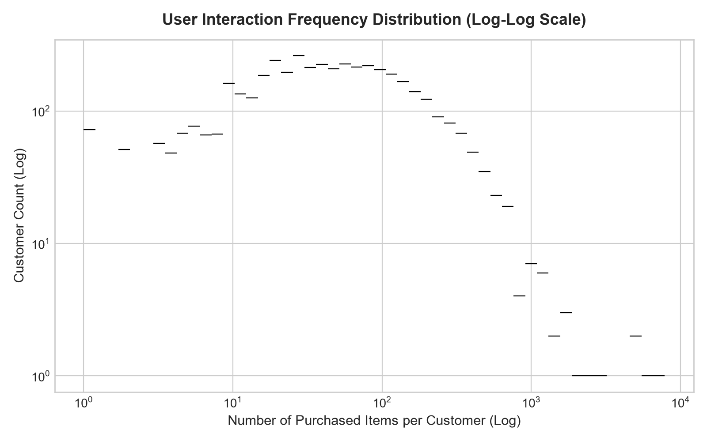
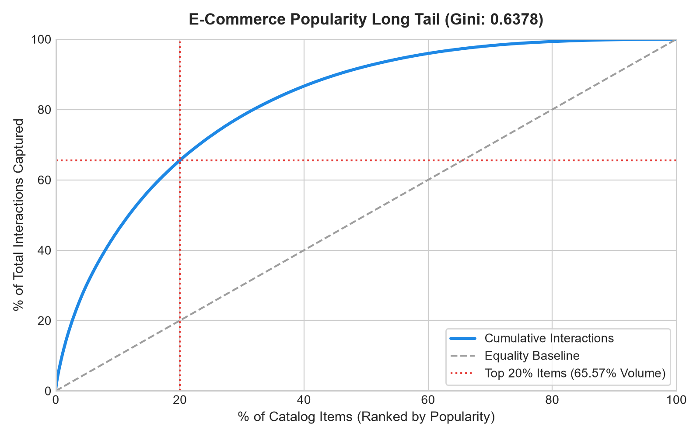
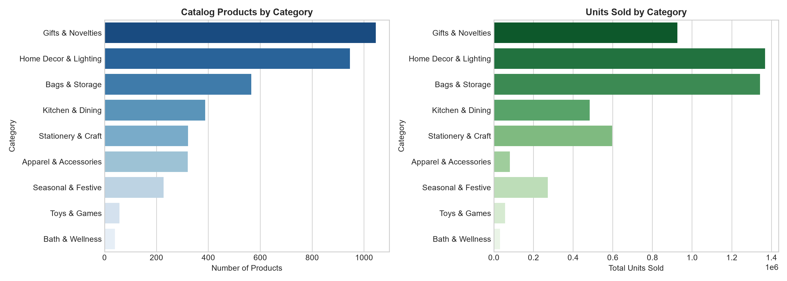
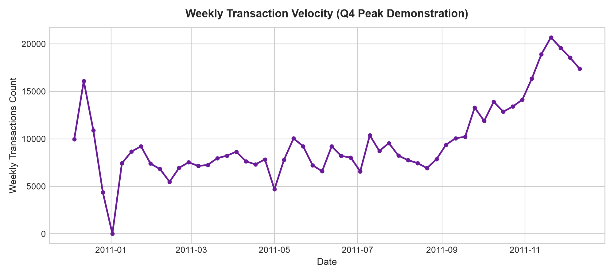

# NEXUS: Exploratory Data Analysis & Sparsity Summary

## 1. Dataset Overview & Sourcing

* **Source Benchmark:** Official UCI Machine Learning Repository Online Retail Benchmark.
* **Author / Origin:** Dr. Daqing Chen, London South Bank University.
* **License:** Creative Commons Attribution 4.0 International (CC BY 4.0).
* **Total Transactions Processed:** 541,909 raw records $\rightarrow$ **527,930 clean transactions**.
* **Identified Customer Transactions:** 396,470 transactions across **4,334 registered customers**.
* **Product Catalog Inventory:** **3,913 unique merchandise products** across 9 structured retail categories.

---

## 2. Interaction Sparsity & Cold-Start Dynamics

```
┌─────────────────────────────────────────────────────────────────────────────┐
│                       INTERACTION SPARSITY METRICS                          │
├─────────────────────────────────────────────────────────────────────────────┤
│ • Total Possible Interaction Cells:  4,334 × 3,913 = 16,958,942             │
│ • Observed User-Item Pairs:          266,250 unique pairs                   │
│ • User-Item Matrix Sparsity:         98.32%                                 │
│ • Matrix Density:                    1.68%                                  │
└─────────────────────────────────────────────────────────────────────────────┘
```

The high matrix sparsity (**98.32%**) demonstrates why naive collaborative filtering alone collapses when evaluating long-tail products or sparse users:
* **The Sparse User Dilemma:** Over 25% of registered customers have completed fewer than 17 lifetime purchases.
* **The Long-Tail Catalog Dilemma:** 50% of catalog merchandise has fewer than 49 total lifetime interactions.

---

## 3. Customer Interaction Distribution

* **Mean Interactions per Customer:** 91.48
* **Median Interactions per Customer:** 41.00
* **25th Percentile ($P_{25}$):** 17.00
* **75th Percentile ($P_{75}$):** 100.00
* **Minimum / Maximum Interactions:** 1 / 7,838 interactions



The interaction distribution follows a classic power-law / heavy-tailed distribution: a small cadre of wholesale buyers interact thousands of times, while the overwhelming majority of consumers make sporadic, low-frequency purchases.

---

## 4. Item Popularity Concentration & The Pareto Principle

* **Item Interaction Gini Coefficient:** **0.6378** (severe inequality in catalog exposure).
* **Pareto 80/20 Rule Verification:** The top 20% of catalog items generate **65.57%** of total transaction volume.
* **Mean Interactions per Product:** 108.33
* **Median Interactions per Product:** 49.00
* **Most Popular Head Product:** `22423` (*REGENCY CAKESTAND 3 TIER*) with 2,035 transactions.



This concentration forms the mathematical basis for the commercial **"Popularity Trap"**: a non-personalized system will continually recommend the top 10 items, starving the remaining 99.7% of catalog inventory.

---

## 5. Retail Category Breakdown

The catalog was synthesized into 9 primary merchandise verticals based on semantic token clustering:

| Retail Category | Catalog Item Count | Total Units Sold | Commercial Role |
| :--- | :---: | :---: | :--- |
| **Gifts & Novelties** | 1,045 | 926,037 | High-volume impulse gift purchases |
| **Home Decor & Lighting** | 946 | 1,367,527 | Core revenue driver; recurring purchases |
| **Bags & Storage** | 565 | 1,342,207 | High unit-velocity wholesale staple |
| **Kitchen & Dining** | 388 | 483,218 | High repeat customer cross-sell vertical |
| **Stationery & Craft** | 322 | 596,356 | Long-tail creative and paper merchandise |
| **Apparel & Accessories** | 321 | 81,026 | Boutique seasonal apparel & wearable items |
| **Seasonal & Festive** | 228 | 272,277 | Sharp Q4 holiday spikes (Christmas/Halloween) |
| **Toys & Games** | 58 | 56,859 | Specialized children's and vintage gifts |
| **Bath & Wellness** | 40 | 31,981 | Long-tail personal care and aromatics |



---

## 6. Temporal Seasonality & Weekly Velocity



Transaction velocity exhibits pronounced weekly stability from December 2010 through September 2011, followed by a dramatic surge in October–November 2011 driven by wholesale holiday pre-orders. This temporal shift reinforces the critical necessity of **chronological partitioning** rather than random interaction splitting.
